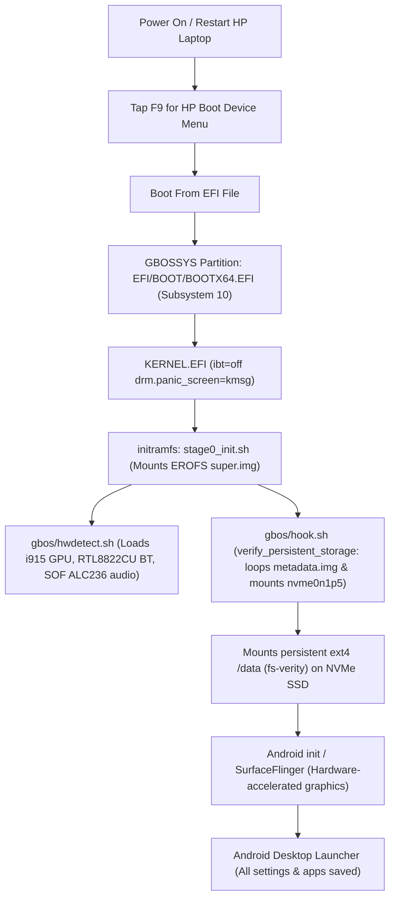

# gbOS86 HP Laptop Port (Intel Alder Lake)

[](LICENSE)
[](docs/HARDWARE_COMPATIBILITY.md)
[](docs/TEST_RESULTS.md)
[](docs/REA_SUPER_REPORT.md)

Production-grade **gbOS86** (Android 14 desktop x86_64) laptop port, native NVMe dual-boot deployment, bootloader decoupling, and peripheral bring-up for the **HP 15s-fr5009TU** laptop powered by the **12th Gen Intel Core i3-1215U (Alder Lake-U)** processor.

> [!IMPORTANT]
> **Independent Project Disclaimer**: This repository contains independent diagnostic notes, reproduction guides, bootloader configurations, reverse engineering dossiers, and patches developed by the community. It is **not** an official Google or gbOS project, nor is it a finished universal Linux distribution.

---

## 1. Status Dashboard

| Subsystem | Target Hardware | Driver / Method | Operational Status |
| :--- | :--- | :--- | :---: |
| **Bootloader** | UEFI 64-bit | `systemd-boot` + `KERNEL.EFI` (`ibt=off`) | **Working** |
| **Processor** | Intel Core i3-1215U (6C / 8T) | Linux Kernel 6.18.21-gbos-whl | **Working** |
| **Graphics** | Intel Alder Lake-P GT1 UHD (`8086:46b3`) | `i915` (KMS / SurfaceFlinger HW accel) | **Working** |
| **Display** | 15.6" 1920x1080 eDP IPS Panel | Native 1080p @ 60 Hz (`DENSITY=180`) | **Working** |
| **Touchpad** | ELAN0718:00 I2C (`04f3:30fd`) | `i2c_hid` with automated IDC file | **Working** |
| **Keyboard** | Internal Laptop Keyboard | Intel HID Event Filter | **Working** |
| **Webcam** | HP True Vision 720p HD Camera | `uvcvideo` (USB Video Class) | **Working** |
| **Wi-Fi** | Realtek / MediaTek Wireless | `rtw88` / `mt7921` (`wlan0`) | **Working** |
| **Bluetooth** | Realtek RTL8822CU Adapter | `btusb` + `btrtl` (`rtl8822cu_fw.bin`) | **Working** |
| **Audio Output** | Intel Alder Lake SOF DSP + ALC236 | `snd_sof_pci_intel_tgl` (`sof-hda-dsp`) | **Working** |
| **Audio Endpoints**| Internal Speakers, Headphone Jack, DMIC | `sof-hda-generic-2ch.tplg` (SSID `103c:8a20`) | **Working** |
| **Setup Wizard** | Google OtaStatusFragment Blocker | Automated provisioning in `hook.sh` | **Working (Bypassed)** |
| **System Updates**| Google update_engine (Error 0x713) | Masked in `hook.sh` | **Suppressed (By Design)** |
| **Persistent Storage**| 24.9 GB NVMe SSD (`/dev/nvme0n1p5`) | Automated ext4 with `fs-verity` + `metadata.img` | **Working (Native NVMe)** |
| **Windows 11 OS** | 512 GB NVMe Partition 3 (444 GB) | Strict size guardrail isolation | **100% Protected & Preserved** |

---

## 2. Dual-Boot Boot Flow Architecture



---

## 3. Major Problem Resolutions & REA Findings

### A. The Windows Boot Manager Error `0xc000007b` Fix
When users attempted to register gbOS86 inside the Windows Boot Manager (`bootmgfw.efi`) via `bcdedit`, Windows crashed at startup:
```text
The application or operating system couldn't be loaded because a required file is missing or contains errors.
File: \EFI\BOOT\BOOTX64.EFI
Error code: 0xc000007b
```
* **Reverse Engineering Cause**: Microsoft's `bootmgfw.efi` strictly checks PE Subsystems. Windows boot files use **Subsystem 16 (`IMAGE_SUBSYSTEM_WINDOWS_BOOT_APPLICATION`)**. Third-party UEFI loaders (`systemd-boot`, Linux kernels) use **Subsystem 10 (`IMAGE_SUBSYSTEM_EFI_APPLICATION`)**. When `bootmgfw.efi` checks the header, Subsystem 10 triggers an immediate `STATUS_INVALID_IMAGE_FORMAT` (NTSTATUS `0xC000007B`).
* **Solution**: Clean up the invalid BCD entry using `scripts/cleanup_broken_bcd.bat` and boot through the native motherboard UEFI menu (**HP F9**).

### B. Automated NVMe Persistent Storage Engine
Stock gbOS86 only supported persistence on a specific 64 GB USB pendrive (`verify_persistent_usb()`) and aborted on NVMe storage, causing Android to reset into "Offline Setup" on every boot.
* **Solution**: Implemented `verify_persistent_storage()` in `hook.sh`:
  1. Loop-mounts `E:\gbos\metadata.img` (64 MB ext4) to `/dev/loop7` for Android `/metadata`.
  2. Detects Partition 5 (`/dev/nvme0n1p5`, 24.9 GB). Verifies sector bounds (40M-65M sectors) to guarantee Windows `C:` (931M sectors) is never touched.
  3. Formats `/dev/nvme0n1p5` to `ext4` with `-O verity -m 0 -L GBOS_DATA` on first boot.
  4. Mounts `/dev/nvme0n1p5` directly to `/new/data` and exports `FROM=nvme`. Data persistence is permanent.

### C. Audio & Bluetooth Bring-up
* **Audio**: Mapped Intel Alder Lake SOF DSP (`intel/sof/sof-adl.ri`, `sof-hda-generic-2ch.tplg`) and Realtek ALC236 codec (`snd_hda_codec_alc269`, SSID `103c:8a20`). Both headphone jack (`0x21`), internal stereo speakers (`0x14`), and DMIC microphone (`0x19`) are functional.
* **Bluetooth**: Realtek RTL8822CU controller initialized with firmware `rtl_bt/rtl8822cu_fw.bin` via `btusb` + `btrtl`. Android Bluetooth stack (`BluetoothManagerService`, `A2DP`, `AVRCP`) active and operational.

---

## 4. Antigravity AI Agent Skill

This repository includes an Antigravity Agent Skill so any developer or agent can reproduce this dual-boot setup:
* Local Path: [SKILL.md](file:///.agents/skills/gbos86-alderlake-dualboot/SKILL.md)
* Global Path: `~/.gemini/config/skills/gbos86-alderlake-dualboot/SKILL.md`

Read the full reverse engineering report in [docs/REA_SUPER_REPORT.md](docs/REA_SUPER_REPORT.md).

---

## 5. Repository Structure

```text
gbos86-hp-laptop-port/
|-- .agents/
|   `-- skills/
|       `-- gbos86-alderlake-dualboot/
|           `-- SKILL.md        # Antigravity Agent skill for automated dual-boot reproduction
|-- configs/
|   |-- gbos.cfg                # Tuned gbOS86 configuration (MODE=boot, DENSITY=180)
|   |-- loader.conf             # systemd-boot timeout and default entry configuration
|   `-- entries/
|       `-- gbos.conf           # Kernel command-line entry (ibt=off drm.panic_screen=kmsg)
|-- patches/
|   |-- 0001-systemd-boot-alder-lake-ibt-off.patch
|   |-- 0002-hwdetect-module-directory-discovery.patch
|   |-- 0003-hook-provisioning-and-ota-suppression.patch
|   |-- 0004-hook-hardened-persistent-usb-storage.patch
|   `-- 0005-hook-nvme-dualboot-persistent-storage.patch
|-- scripts/
|   |-- cleanup_broken_bcd.bat  # Removes invalid BCD bootapp entry causing 0xc000007b
|   |-- remove_boot_menu.bat    # Restores default Windows instantaneous boot
|   |-- install_dualboot.bat    # Staging script for dual-boot SSD deployment
|   |-- apply_port_patches.py   # Python utility to apply patches to system files
|   `-- verify_persistent_usb.sh # Standalone POSIX verification logic
`-- docs/
    |-- REA_SUPER_REPORT.md     # Comprehensive Reverse Engineering Dossier
    |-- HARDWARE_COMPATIBILITY.md # Component matrix for HP 15s-fr5009TU
    |-- TEST_RESULTS.md         # Empirical test evidence from Boot-1 through Boot-9
    |-- BUILD_AND_BOOT.md       # Step-by-step reproduction and flashing guide
    |-- PERSISTENCE_AND_STORAGE.md # Storage architecture, fs-verity, and metadata loop
    |-- CHANGELOG.md            # Chronological boot-by-boot diagnostic logs
    `-- KNOWN_ISSUES.md         # Documented limitations
```

---

## 6. License

Licensed under the [MIT License](LICENSE).  
Portions of scripts and referenced configurations derive from Android-x86, Linux Kernel (GPLv2), KernelSU (GPLv3), and Android Open Source Project (Apache 2.0).
