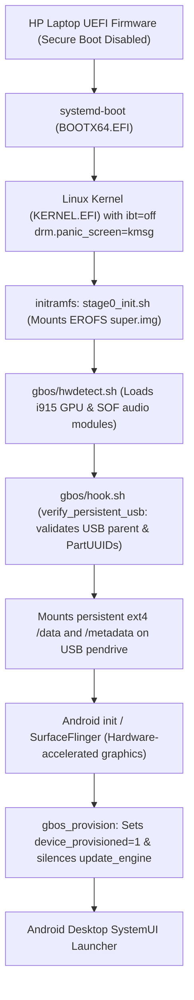

# gbOS86 HP Laptop Port (Intel Alder Lake)

[](LICENSE)
[](docs/HARDWARE_COMPATIBILITY.md)
[](docs/TEST_RESULTS.md)

Experimental **gbOS86** (Android-x86) laptop port, bootloader decoupling, and boot troubleshooting notes for the **HP 15s-fr5009TU** laptop powered by the **12th Gen Intel Core i3-1215U (Alder Lake)** processor.

> [!IMPORTANT]
> **Independent Project Disclaimer**: This repository contains independent diagnostic notes, reproduction guides, bootloader configurations, and patches developed by the community. It is **not** an official Google or gbOS project, nor is it a finished universal Linux distribution.

---

## 1. Status Dashboard

| Subsystem | Target Hardware | Driver / Method | Operational Status |
| :--- | :--- | :--- | :---: |
| **Bootloader** | UEFI 64-bit | `systemd-boot` + `KERNEL.EFI` (`ibt=off`) | **Working** |
| **Processor** | Intel Core i3-1215U (6C / 8T) | Linux Kernel 6.18.21-gbos-whl | **Working** |
| **Graphics** | Intel Alder Lake-P GT1 UHD (`8086:46b3`) | `i915` (KMS / SurfaceFlinger HW accel) | **Working** |
| **Display** | 15.6" 1920x1080 eDP IPS Panel | Native 1080p @ 60 Hz (`DENSITY=180`) | **Working** |
| **Touchpad** | ELAN0718:00 I2C (`04f3:30fd`) | `i2c_hid` with automated IDC file | **Working** |
| **Keyboard** | Internal Laptop Keyboard | Intel HID Event Filter | **Working** |
| **Webcam** | HP True Vision 720p HD Camera | `uvcvideo` (USB Video Class) | **Working** |
| **Wi-Fi** | Realtek / Intel Wireless | `rtw88` / `iwlwifi` | **Partially Working** |
| **Bluetooth** | Realtek / Intel Bluetooth Adapter | `btusb` | **Working** |
| **Audio Output** | Intel Alder Lake Smart Sound (SOF) | `snd_sof_pci_intel_tgl` (`sof-hda-dsp`) | **Needs Verification** |
| **Setup Wizard** | Google OtaStatusFragment Blocker | Automated provisioning in `hook.sh` | **Working (Bypassed)** |
| **System Updates**| Google update_engine (Error 0x713) | Masked in `hook.sh` | **Suppressed (By Design)** |
| **USB Storage** | 64 GB USB Pendrive (ext4) | Hardened 14-gate `verify_persistent_usb()` | **Experimental** |
| **Internal SSD** | 512 GB NVMe (`WD PC SN740`) | Strict sysfs USB ancestry isolation | **Protected (Untouched)** |

---

## 2. Boot Flow Architecture



---

## 3. Key Technical Challenges Solved

### 1. Alder Lake CET / IBT Kernel Panic (`ibt=off`)
Intel 12th Gen CPUs enforce Indirect Branch Tracking (IBT). The upstream KernelSU trampolines lacked `ENDBR64` landing pad instructions, triggering an immediate CPU fault (`Missing ENDBR: ksu_handle_init`) on boot. Because the stock image shipped a sealed Unified Kernel Image (UKI), the bootloader was decoupled into `systemd-boot` to pass `ibt=off`.

### 2. Kernel Module Directory Lookup Mismatch
`uname -r` reported `6.18.21-gbos-whl`, but the ISO module directory was named `6.18.21-gbos-whl+` (with a trailing plus sign). Patched `hwdetect.sh` to probe both versions, allowing Intel i915 and SOF audio drivers to load.

### 3. Setup Wizard OTA Error 0x713 Bypass
Google's Setup Wizard failed verification on a missing dynamic 12.88 GB super partition, permanently blocking first-boot setup. Added `gbos_provision` to `hook.sh` to inject `device_provisioned 1`, `user_setup_complete 1`, and masked `update_engine.rc`.

### 4. Hardened 14-Gate Persistent USB Storage
Converted the live USB into a standalone persistent installation using unallocated space on the 64 GB drive. Designed `verify_persistent_usb()` in `hook.sh` enforcing USB parent ancestry, GPT PartUUID matching via bundled `sfdisk -d`, path canonicalization, and sector bounds to guarantee the internal NVMe SSD is never touched.

---

## 4. Repository Structure

```text
gbos86-hp-laptop-port/
|-- .gitignore                  # Ignore rules for raw ISOs, images, and large logs
|-- LICENSE                     # MIT License with third-party upstream notices
|-- README.md                   # Project overview, architecture, and quick start
|-- CONTRIBUTING.md             # Guidelines for test logs and pull requests
|-- configs/
|   |-- gbos.cfg                # Tuned gbOS86 configuration (MODE=boot, GPU_SOFTWARE=auto)
|   |-- loader.conf             # systemd-boot timeout and default entry configuration
|   `-- entries/
|       `-- gbos.conf           # Kernel command-line entry (ibt=off drm.panic_screen=kmsg)
|-- gbos/
|   `-- logs/                   # Raw hwdetect.txt logs from Boot-1 through Boot-9
|       |-- boot-1/hwdetect.txt
|       |-- ...
|       `-- boot-9/hwdetect.txt
|-- patches/
|   |-- 0001-systemd-boot-alder-lake-ibt-off.patch
|   |-- 0002-hwdetect-module-directory-discovery.patch
|   |-- 0003-hook-provisioning-and-ota-suppression.patch
|   `-- 0004-hook-hardened-persistent-usb-storage.patch
|-- scripts/
|   |-- apply_port_patches.py   # Python utility to apply patches to a mounted USB drive
|   `-- verify_persistent_usb.sh # Standalone POSIX verification logic for BusyBox
`-- docs/
    |-- BUILD_AND_BOOT.md       # Complete step-by-step reproduction and flashing guide
    |-- CHANGELOG.md            # Chronological boot-by-boot diagnostic logs (Boot 1 to 9)
    |-- HARDWARE_COMPATIBILITY.md # Component matrix for the HP 15s-fr5009TU
    |-- KNOWN_ISSUES.md         # Documented limitations, timberslide crash-loop, etc.
    |-- TEST_RESULTS.md         # Empirical test evidence from live and persistent runs
    |-- PERSISTENCE_AND_STORAGE.md # Storage architecture, 14-gate verification, and fs-verity
    |-- SECURITY_AND_LIMITATIONS.md # Threat model, SELinux permissive mode, and OTA policy
    `-- GBOS_WEBSITE_ANNOUNCEMENT.md # Formatted release announcement for the gbOS forum
```

---

## 5. Quick Reproduction Outline

1. **Flash Base Image**: Write official gbOS86 image to a 64 GB USB pendrive.
2. **Setup systemd-boot**: Replace `BOOTX64.EFI` with `systemd-boot`, rename kernel to `KERNEL.EFI`, and configure `loader/entries/gbos.conf` with `ibt=off`.
3. **Partition Persistent Storage**: Create Partition 3 (`GBOS_META`, 64 MiB ext4) and Partition 4 (`GBOS_DATA`, ~52 GiB ext4) on the USB drive.
4. **Apply Patches**: Apply the 4 patches in `patches/` to `gbos/hwdetect.sh` and `gbos/hook.sh`.
5. **Boot Laptop**: Disable Secure Boot in BIOS (F10), select USB boot (F9), and allow 5–7 minutes for initial package indexing.

For the full detailed instructions, see [docs/BUILD_AND_BOOT.md](docs/BUILD_AND_BOOT.md).

---

## 6. Safety Warning: Internal SSD Protection

> [!CAUTION]
> **Do not write to Disk 0 (Internal NVMe)**:
> This project is designed to run **exclusively from a USB pendrive**. The internal Windows installation (`WD PC SN740` NVMe SSD) is strictly protected by physical subsystem ancestry checks in `verify_persistent_usb()`. Never run manual format commands or point installers to `nvme0n1`.

---

## 7. License

Licensed under the [MIT License](LICENSE).  
Portions of scripts and referenced configurations derive from Android-x86, Linux Kernel (GPLv2), KernelSU (GPLv3), and Android Open Source Project (Apache 2.0).
