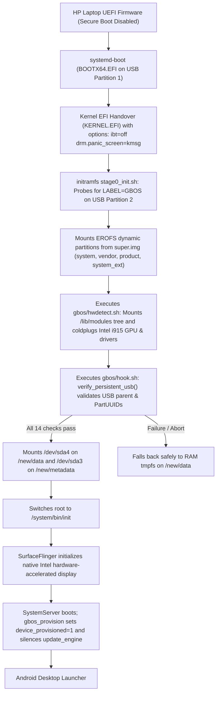

# Build and Boot Guide: gbOS86 on HP 15s-fr5009TU

This guide documents the exact, reproducible process to prepare a bootable USB pendrive running gbOS86 on the **HP 15s-fr5009TU** laptop (and compatible Intel 12th/13th Gen Alder Lake systems).

---

## 1. Architecture & Boot Chain Overview

The gbOS86 boot flow on this hardware relies on a custom hybrid UEFI-to-Android sequence:



---

## 2. Prerequisites & Equipment

* **Target Hardware**: HP 15s-fr5009TU laptop (Intel Core i3-1215U, 8 GB RAM).
* **Storage Media**: 64 GB USB 3.0 / 2.0 Flash Drive (e.g., `Generic Flash Disk`).
* **Source Image**: Official `gbOS86` release image or ISO from the project source.
* **Host PC**: Windows 11 or Linux workstation with administrative / root access for disk preparation.
* **Tools**: `systemd-boot` (x86_64 binary), Python 3.8+, `git`.

> [!CAUTION]
> **Data Loss Warning**: Never target your internal NVMe/SATA SSD (Disk 0) with partition or format commands. Always positively verify the disk number and serial number of your USB drive before writing.

---

## 3. Step-by-Step Installation & Reproduction

### Step 1: Flash the Base Image to the USB Pendrive
Write the original gbOS86 image to the USB drive using a block flasher (such as Rufus in DD mode, balenaEtcher, or Linux `dd`):
```bash
# Linux example (replace /dev/sdX with your verified USB disk node):
sudo dd if=gbos86-release.img of=/dev/sdX bs=4M status=progress conv=fsync
```

### Step 2: Separate the Bootloader & Deploy `systemd-boot`
The original image ships with a unified kernel image (UKI) located at `EFI/BOOT/BOOTX64.EFI`. On Intel 12th Gen Alder Lake CPUs, the kernel panics on boot due to missing `ENDBR64` instructions in the KernelSU hook trampolines. To pass `ibt=off`, separate the bootloader:

1. Mount the FAT32 `EFI` partition (Partition 1) on your workstation.
2. Rename `EFI/BOOT/BOOTX64.EFI` to `EFI/BOOT/KERNEL.EFI`.
3. Copy a standard x86_64 `systemd-boot` binary into `EFI/BOOT/BOOTX64.EFI`.
4. Create the loader configuration directory: `loader/entries/`.
5. Create `loader/loader.conf`:
   ```ini
   timeout 3
   default gbos.conf
   console-mode max
   editor yes
   ```
6. Create `loader/entries/gbos.conf`:
   ```ini
   title gbOS86 (Alder Lake CET fix)
   linux /EFI/BOOT/KERNEL.EFI
   options ibt=off drm.panic_screen=kmsg
   ```

### Step 3: Partition the Unallocated USB Space for Persistent Storage
The base gbOS86 image occupies ~6.25 GB, leaving ~52.7 GB unallocated on a 64 GB flash drive. Partition the remaining space with GPT:

| Partition | Size | Type GUID | Filesystem | Label | PartUUID |
| :---: | :---: | :---: | :---: | :---: | :---: |
| **1** | 256 MiB | `c12a7328-f81f-11d2-ba4b-00a0c93ec93b` (EFI) | FAT32 | `EFI` | `1631d757-923f-455b-81f2-b22143726311` |
| **2** | 6.00 GiB | `ebd0a0a2-b9e5-4433-87c0-68b6b72699c7` (Basic Data) | FAT32 | `GBOS` | `051ed1b9-82ff-481a-9b22-59ceb65986c3` |
| **3** | 64 MiB | `0fc63daf-8483-4772-8e79-3d69d8477de4` (Linux Data) | ext4 | `GBOS_META` | `30715566-bd33-4e69-8d7e-070776e2d0a6` |
| **4** | ~52.7 GiB | `0fc63daf-8483-4772-8e79-3d69d8477de4` (Linux Data) | ext4 | `GBOS_DATA` | `19954bef-db10-4d1b-8404-17d5cb7ec97c` |

Format the persistent partitions with ext4 journaling:
```bash
# Replace /dev/sdX3 and /dev/sdX4 with your verified USB partition nodes:
mkfs.ext4 -F -L GBOS_META -U 8e5d9e62-3a24-46fd-8d96-4077c38fae44 /dev/sdX3
mkfs.ext4 -F -L GBOS_DATA -U 8fb16737-a46a-442c-af5c-3ef60d77d655 -O verity /dev/sdX4
```

### Step 4: Apply the Port Patches
Mount Partition 2 (labeled `GBOS`) and apply the patches provided in this repository's `patches/` directory:

1. **Fix Module Directory Discovery**:
   Apply [`patches/0002-hwdetect-module-directory-discovery.patch`](../patches/0002-hwdetect-module-directory-discovery.patch) to `gbos/hwdetect.sh`.
2. **Apply Setup Wizard & OTA Suppression**:
   Apply [`patches/0003-hook-provisioning-and-ota-suppression.patch`](../patches/0003-hook-provisioning-and-ota-suppression.patch) to `gbos/hook.sh`.
3. **Deploy Hardened Persistent USB Logic**:
   Apply [`patches/0004-hook-hardened-persistent-usb-storage.patch`](../patches/0004-hook-hardened-persistent-usb-storage.patch) to `gbos/hook.sh`.
4. **Configure `gbos.cfg`**:
   Copy [`configs/gbos.cfg`](../configs/gbos.cfg) to `gbos/gbos.cfg`. Ensure `MODE=boot`, `LOAD_I915=1`, and `GPU_SOFTWARE=auto` are set.

---

## 4. Booting on the HP Laptop

1. **BIOS / UEFI Settings**:
   - Power on the HP laptop and press **F10** repeatedly to enter BIOS Setup.
   - Disable **Secure Boot** (required because `KERNEL.EFI` uses a custom kernel with KernelSU not signed by Microsoft 3rd Party UEFI CA).
   - Ensure USB Boot is enabled. Save changes and exit.
2. **Boot Selection**:
   - Plug the prepared USB stick into a USB Type-A port.
   - Power on and press **F9** repeatedly to open the HP Boot Device Options menu.
   - Select your USB drive under UEFI Boot Devices.
3. **Execution**:
   - `systemd-boot` will countdown 3 seconds and automatically launch `gbOS86 (Alder Lake CET fix)`.
   - **Initial Boot Window**: On the very first boot on persistent storage, Android's `PackageManagerService` compiles directories for ~312 system packages. Allow **5 to 7 minutes** undisturbed while the boot animation plays smoothly.
   - Once package initialization completes, the screen transitions to the Android desktop.
