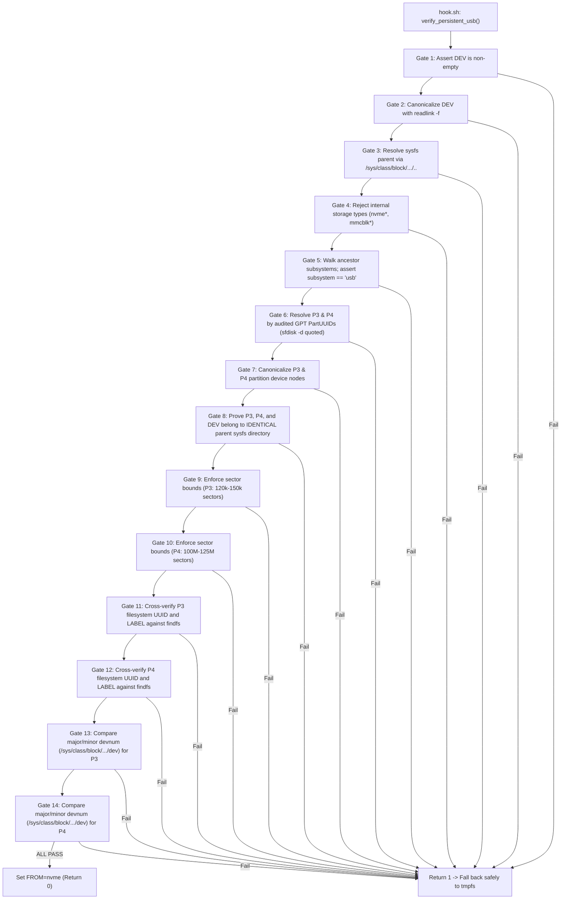

# Persistent Storage Design & Safety Hardening

This document explains the architecture, security mechanisms, and verification procedures for persistent storage on the gbOS86 USB installation.

---

## 1. Storage Architecture Overview

In stock gbOS86 live boots, Android's `/data` and `/metadata` directories are mounted as `tmpfs` (RAM-backed filesystems). Consequently, all installed applications, user configurations, and accounts are lost on power-off.

To convert gbOS86 into a fully persistent operating system running entirely from the 64 GB USB pendrive, unallocated flash space was partitioned into two dedicated ext4 filesystems:

```text
[Disk 1: 64 GB USB Pendrive (Generic Flash Disk, Serial 634453C7)]
|-- Partition 1 (256 MiB FAT32):  EFI System (systemd-boot + KERNEL.EFI)
|-- Partition 2 (6.00 GiB FAT32): GBOS (system images, super.img, hook.sh, gbos.cfg)
|-- Partition 3 (64 MiB ext4):    GBOS_META (Android metadata, PartUUID 30715566-...)
`-- Partition 4 (52.67 GiB ext4): GBOS_DATA (Android persistent /data, PartUUID 19954bef-...)
```

---

## 2. Stage-0 Control Flow & `FROM=nvme` Variable Semantics

In `stage0_init.sh` (lines 185–206), the persistence mounting logic is gated by the variable `$FROM`:

```bash
# Sourced from hook.sh
DATA=; META=
if [ $FROM = nvme ]; then
  DATA=$(findfs LABEL=GBOS_DATA 2>/dev/null); META=$(findfs LABEL=GBOS_META 2>/dev/null)
fi

if [ -n "$DATA" ] && [ -n "$META" ]; then
  e2fsck_p $META; e2fsck_p $DATA
  mount -t ext4 -o noatime,nosuid,nodev $META /new/metadata
  mount -t ext4 -o noatime,nosuid,nodev $DATA /new/data
else
  mount -t tmpfs -o mode=0771 tmpfs /new/data
  mount -t tmpfs tmpfs /new/metadata
  log "data/metadata: tmpfs (not persistent)"
fi
```

### Forensic Proof on Variable Meaning:
* Despite the name `FROM=nvme`, **this variable does NOT access NVMe hardware**.
* In `stage0_init.sh`, it is used strictly as a **boolean flag**.
* If `$FROM == "nvme"`, stage 0 executes `findfs LABEL=GBOS_DATA` and mounts ext4.
* If `$FROM != "nvme"`, stage 0 safely defaults to `tmpfs` (RAM live mode).

---

## 3. The 14-Gate Hardened Verification Function (`verify_persistent_usb`)

To ensure that gbOS86 **NEVER** mounts or targets internal NVMe/SATA SSDs, the verification logic in `gbos/hook.sh` enforces 14 independent safety checks before setting `FROM=nvme`:



---

## 4. Test Verification Under Initramfs BusyBox `sh`

The exact `verify_persistent_usb()` implementation was tested against all failure modes using the real initramfs binary (`BusyBox v1.37.0`):

1. **Test 1 (Happy Path)**: USB parent, matching PartUUIDs, valid ext4 UUIDs -> **PASS (`FROM=nvme`)**
2. **Test 2 (Internal NVMe)**: Parent disk `nvme0n1` -> **PASS (Aborted to `tmpfs`)**
3. **Test 3 (Non-USB SATA Bus)**: Subsystem `ata` -> **PASS (Aborted to `tmpfs`)**
4. **Test 4 (PartUUID Mismatch)**: Mismatched partition GUID -> **PASS (Aborted to `tmpfs`)**
5. **Test 5 (Foreign Parent Mismatch)**: P4 on separate disk -> **PASS (Aborted to `tmpfs`)**
6. **Test 6 (Sector Bounds Out of Range)**: Unexpected partition size -> **PASS (Aborted to `tmpfs`)**
7. **Test 7 (Filesystem UUID Mismatch)**: Filesystem UUID altered -> **PASS (Aborted to `tmpfs`)**

---

## 5. Zero Formatting in Boot Path

Early prototype drafts included formatting calls (`mke2fs`) if persistent partitions were unformatted. To prevent any risk of data loss or accidental re-formatting:
* **All `mke2fs` commands were 100% removed from `hook.sh`**.
* Both partitions must be pre-formatted. If verification fails, the system logs `SAFETY ABORT` and safely defaults to non-persistent `tmpfs`.
